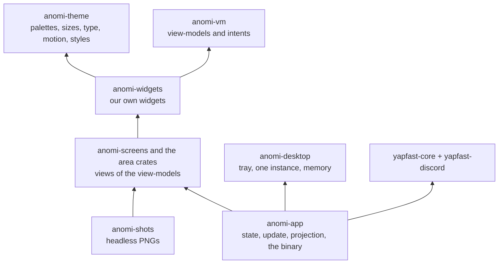
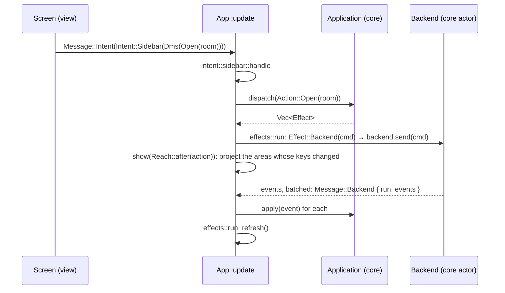

# The iced interface

Anomi is getting a second interface, written with [iced](https://github.com/iced-rs/iced)
beside the Slint one, on the same core: `crates/yapfast-core` and
`crates/yapfast-discord` stay as upstream has them, so upstream's fixes keep
merging. The iced interface grows screen by screen until it does everything
the Slint one does; then the Slint one goes. This page is the architecture
for the agents who write it (writers) and those who check it (reviewers).
The iced API at the pinned commit is in [iced-notes.md](iced-notes.md); the
work, task by task, is in [tasks.md](tasks.md); the widgets, view-model types
and fixtures waves 1 to 3 built, and the pieces the screens share, with
their entry points, in [widgets.md](widgets.md).

Run it against the fake Discord, as the Slint app runs:

```sh
scripts/ui-session start --discord --anomi --size 1400x860
scripts/ui-session do 'click 150 281' 'theme catppuccin-latte' 'language en' 'shot dm'
```

## Crates and layers



| Crate | Holds | Depends on | Who edits it |
| --- | --- | --- | --- |
| `anomi-theme` | the twelve palettes (`builtin/`), `Theme` and every built-in widget's style catalog (`catalog/`), `metrics`, `typography`, `motion`, `fonts` (DM Sans, and `install()`, which puts every font in iced's font system with the fallback the interface wants), the `View` and `Element` types, the `Renderer` and `renderer` (a processor's renderer of its own, which kind draws) | iced, iced_tiny_skia, anomi-fonts | writers |
| `anomi-vm` | per area: the view-model a screen draws and the `Intent` it sends, the larger areas in folders (`sidebar/`, `places/`, `chat/`, `people/`, `voice/`, `settings/`); `kind` for shared vocabulary (avatar, presence, tag, status, name style and nameplate, profile effect and frame); `icon` (`Icon`); `text` for spans; `menu`, `shell` (layers); `fixtures` (feature) for samples, the fake's pictures and `Shot` | iced (for `image::Handle`, `svg::Handle`), pulldown-cmark, emojis | writers |
| `anomi-widgets` | one module per widget ([widgets.md](widgets.md)): compositions (`avatar`, `badge`) and widgets of our own (`list`, `picture`, `paragraph`, `composer`, `layer`, `menu`...) | theme, vm, yapfast-lang, image (PNG) | writers; the hard widgets are Opus tasks |
| `anomi-screens` | the window (`shell`), its chrome and its areas, one folder per area, one module per component; `shots` (feature) lists what `anomi-shots` renders | theme, widgets, vm, yapfast-lang, the area crates | writers |
| `anomi-chat`, `anomi-people`, `anomi-voice`, `anomi-settings` | the larger areas, split off so each compiles on its own: one module per task, drawing `anomi_vm::<area>`; the shell places them. They don't depend on each other | theme, widgets, vm, yapfast-lang | writers |
| `anomi-fonts` | Twemoji as a colour font (its build script makes it from `vendor/twemoji/72x72`, cached in `OUT_DIR`), the eleven display-name faces, which fonts draw Chinese, Japanese and Korean first, and the person's own font files (copies, WOFF); no iced | emojis, unicode-script, yapfast-lang, sha2, tempfile, memmap2, flate2 | F03 |
| `anomi-shots` | renders each screen from its fixture to PNG, no display, with the app's fonts and picture scale | screens, widgets, iced_runtime, png | reviewers run it |
| `anomi-desktop` | what both clients ask of the desktop beyond their toolkit: the tray icon, one instance a data folder and bringing its window forward, the window's icon, giving memory back; the Slint app (`src/`) uses it too | image, raw-window-handle, ksni (Linux), wayland-client (Linux), windows-sys (Windows), yapfast-lang | I14 and the I tasks after it |
| `anomi-app` | `App` (the program's state), `update`, the projection of the core's `AppState` (`project/`), intents to `Action`s (`intent/`), effects to tasks (`effects`), the backend, `layout.json`, the `anomi` binary | everything above and yapfast-core with `discord` | Opus integration tasks, never writers |

The rule that makes this work: **nothing a writer touches depends on
yapfast-core**. The core's `livekit` and `webrtc-sys` aren't optional and
its `discord` feature builds x264, FFmpeg and thorvg; any crate above it pays
for that in every `cargo check`. So screens draw view-models, plain data the
app fills from the core, as `src/ui/refresh.rs` fills the Slint window
today. A writer's check builds iced and nothing native.

Every crate takes iced from one entry in the root `Cargo.toml`
(`[workspace.dependencies] iced`), so the whole graph builds once with one
feature set; never give a crate iced features of its own.

### What draws

`anomi_theme::Renderer` is iced's fallback renderer, built with both of
its renderers in every build: wgpu on a graphics adapter first
(`vendor/iced_wgpu`), tiny-skia on the processor second
(`vendor/iced_tiny_skia`). The window takes the first that starts. wgpu
starts only once the program enables it and an adapter is chosen, which
only `anomi-app` does, from Settings; it falls back to the processor when
the adapter can't start or is lost, and the person can switch while the
window is open (`iced::backend::configure`; [below](#choosing-what-draws)).
So:

- Widgets and views draw through iced's renderer traits only (quads,
  text, pictures, SVG, geometry, layers and transformations), which both
  renderers implement. None matches on the renderer's variant or names
  `iced_tiny_skia::Renderer`; `anomi_theme::renderer::is_gpu` is for what
  the program shows about it.
- A geometry is drawn only by the kind of renderer that made it, or iced's
  fallback renderer reaches `unreachable!()`. Make geometry from the
  renderer being drawn with, in that draw; one kept across frames is kept
  with the kind it was made for and made anew from an empty cache when the
  kind changes (`anomi-widgets/src/name/drawn.rs`).
- What must draw on the processor whatever the window uses makes a renderer
  of its own with `anomi_theme::renderer::software(settings)`: the shots,
  the tests' renderers, and a faded styled name's picture.

### Choosing what draws

`anomi-app/src/gpu` decides by the owner's rule: on a computer with
integrated graphics the window draws on them, so the discrete card stays
with the game; where none can, on the processor; on a discrete card only
when it's chosen by hand. Settings' Advanced offers Automatic (the
default), the processor and each adapter; `layout.json` keeps the choice
as `interface_renderer` (`"auto"`, `"processor"` or an adapter's key from
`yapfast_core::adapters`, `"pci:0000:73:00.0"`), the GPU's failures in a
row as `renderer_failures` and the adapter a window is opening on as
`renderer_trying`; the Slint app's `gpu_rendering` stays as it came and
decides nothing here. `--renderer auto|gpu|software` and
`--adapter 0000:73:00.0` choose for one run.

- **At the start**, before any thread, `cli::main` reads the choice, the
  system's adapters (sysfs: no driver loads) and which Vulkan drivers are
  installed (their manifests), and sets `VK_LOADER_DRIVERS_SELECT` to the
  driver of the adapter that may draw, so the Vulkan loader never loads
  another into the process (while the processor draws, Automatic's
  adapter's, for a switch; without integrated graphics, every adapter's).
  A variable of the loader's the person set stands. An adapter without a
  Vulkan driver, one chosen and gone, or three failures in a row leave
  the processor, and Settings says why; over the window too where the
  adapter was chosen by hand. `run`, never `App::new`, then enables wgpu
  with that adapter (`iced_wgpu::enabled`, `iced_wgpu::adapter::choose`),
  so the app's tests draw on the processor. iced's backend is `Best` (wgpu
  if enabled, else tiny-skia), presenting at the display's pace (FIFO),
  paths antialiased (MSAA x4).
- **How the frames reach the window** depends on the adapter the desktop
  composites on, which `gpu::screen` finds before the window opens and
  tells wgpu (`iced_wgpu::adapter::set_display_adapter`): on Wayland the
  compositor's own word, the main device of linux-dmabuf's default
  feedback, over a connection of its own (one round trip); without it
  (X11, an older compositor) the computer's only adapter, else the only
  one a monitor is plugged into; with none or several, not known. Only
  that adapter draws into a Vulkan surface of the window. Any other, or
  every one when it isn't known, draws into a texture of its own whose
  frame is read back and shown through shared memory, as the processor's
  frames are (`vendor/iced_wgpu/PATCHES.md`, "Drawn on one adapter, shown
  through another"): a compositor that can't import another adapter's
  buffers ends a Wayland connection with a protocol error, which nothing
  survives, and Vulkan can't tell beforehand. On the owner's desktop
  (mutter and the monitor on the RTX 3080) Automatic draws on the Radeon
  610M that way. Only what changed is drawn there, read back and shown
  (`vendor/iced_wgpu/PATCHES.md`, "Only what changed, read back and
  shown"): a frame's layers are held against the frame before's as
  tiny-skia's are, the window's buffer gets what it lacks of the frame
  (two frames' changes on Wayland), and the compositor is told the frame's
  own change, so it uploads only that; a frame that changes nothing reads
  back nothing. It costs the window's thread 3.6 ms a frame at 1400 by 868
  and 8.5 ms maximised at 3440 by 1408 while a channel scrolls, and 2.1
  and 3.5 ms for a key typed (drawn and read back whole: 4.7 and 10.8 ms,
  4.4 and 10.8 ms); with gnome-shell, it takes less CPU than the processor
  scrolling and about as much for a small change (`docs/measurements/README.md`,
  "Drawn on the Radeon, shown through shared memory"). `ANOMI_SHARED_VERIFY=1` holds
  each frame shown against the frame drawn whole and logs the pixels that
  differ, for a review. The log says which: "the window draws
  on …, shown through shared memory" or "…, presented to the window
  directly". `ANOMI_FRAMES_VERIFY=1`, on either renderer, warns "a frame's
  bytes changed …" for a video frame its worker wrote after lending it to
  the window, or while the renderer read it
  (`vendor/iced_tiny_skia/PATCHES.md`, "A frame's bytes checked while
  they're drawn").
- **The adapters Settings lists** come from `anomi --list-adapters`, a
  child process started once a run, the first time the page asks:
  enumerating Vulkan's adapters loads every installed driver, which would
  stay in the window's process. It prints the system's adapters as JSON,
  each usable where Vulkan offers it (matched by PCI address). Until it
  answers the page shows the system's list, each usable where its driver
  is installed, and it's built again when the answer comes.
- **Switching** (`gpu::choose`) keeps the choice, forgets the failures and
  makes the window's renderer again through `iced::backend::configure`: no
  restart, and a call goes on. A driver the start didn't let load waits
  for the next start, and Settings says so. From a GPU to the processor
  the device and the Vulkan instance go, and the loader unloads the
  driver with them: nothing of it stays in the process.
- **Failures.** A GPU that doesn't start (iced's fallback has tiny-skia
  draw) or fails under the window (`iced_wgpu::lost`: a lost device, an
  error wgpu caught, a surface it couldn't make or that gives no frame
  three times in a row) gives way to the processor from the next frame
  (`configure` with `Backend::Software`); the
  hook runs on a renderer's thread and hands `update` a message through a
  channel the app's subscription waits on. The banner over the sign-in
  card and the conversation says why, and `renderer_failures` counts it.
  The next start tries again; after three in a row the processor draws
  until a GPU is chosen again. A death the app can't count, a crash, an
  abort or a Wayland protocol error, is caught by `renderer_trying`: each
  window about to open on a GPU (and each switch to one) writes its
  adapter there first and waits until it's on disk, and it's cleared 5
  seconds after the first frame drawn there (or after the GPU was given
  up), or by a quit the person asks for. A start that finds it set draws
  on the processor, and Settings and the window say why, until a GPU is
  chosen again: one death is enough. The failures in a row go back to 0
  then too, not at the first frame: a compositor's refusal comes after
  it, and the app's drop, which runs as a dead Wayland connection ends the
  event loop, would write a reset made then. Automatic finding no
  integrated graphics in Vulkan is the rule, not a failure.
- **Idle.** wgpu draws only when iced asks, as tiny-skia does: into a
  Vulkan surface the whole window each time, read back only what changed.
  A surface with no image for a second counts as
  occluded and isn't redrawn in a loop (`vendor/iced_wgpu/PATCHES.md`).
  `gpu` asks for no frame: its subscription waits on that channel and on
  windows opening, follows frames only from a window opening on the GPU
  with a try or failures to settle until its first frame, and then waits
  once, 5 seconds. A frame read back costs nothing between frames: no
  thread, no timer. In the tray iced drops
  the compositor and with it the device, the swapchain, the atlases and
  the Vulkan instance, and the loader unloads the driver: no library or
  thread of RADV's or NVIDIA's stays (measured: docs/measurements/README.md,
  "Drawing on a graphics adapter"). Behind another window the Radeon wakes
  nothing; NVIDIA's driver keeps a thread waking 4 times a second while
  its device lives, so a discrete card is never Automatic's.

## Modules, files and names

- **One folder per area, one module per component.** An area is a part of
  the window with its own Slint file: `rail`, `sidebar`, `conversation`,
  `composer`, `friends`, `voice`... The same area has the same name in
  `anomi-vm/src/<area>`, the screens crate's `src/<area>` and
  `anomi-app/src/{project,intent}/<area>`.
- **Name things after the Slint side**, in Rust's case: `RailItem` becomes
  `rail_item::RailItem`, the struct `RoomRow` becomes `sidebar::DmRow` or
  `ChannelRow` as it splits. Each module's doc names the Slint component and
  the glue (`file:line`) it ports, so a reviewer can hold them side by side.
- **400 lines a file at most**, tests included; `scripts/check-iced` fails
  a longer one. Split by component, not by kind of code.
- **No colour, size or duration literal in a screen**: they come from
  `anomi-theme` (`theme.palette()`, `metrics`, `typography`, `motion`). A
  value one widget needs and nothing else may stay in that widget's module
  as a named constant with the Slint line it came from.
- Text the person reads goes through `tr!` (see [Translation](#translation)).
- Every module starts with `use anomi_theme::prelude::*;`, which brings
  `View`, `Element`, `Theme`, `Motion` and iced's `Widget` trait (for
  `.boxed()` and `.map()`).

### Shared files

Writers work in parallel, each in the files its task owns
([tasks.md](tasks.md)), so nothing two areas need may live in one file that
both would edit:

- **Parent modules come first.** Task F01 created every module a task
  names, as a stub, with its `mod` line in the parent (`lib.rs`, `mod.rs`),
  its `Vm` field and its `Intent` variant. The larger areas keep their
  modules in folders whose `mod.rs` F01 keeps
  (`anomi-vm/src/{sidebar,places,chat,people,voice,settings}/mod.rs`): one
  field and one variant per module, flat, and a `parts!` line giving each
  module's `Intent` a `From` into its folder's and into the window's. A
  task fills its own files and adds no line elsewhere.
- **Map with `From`.** A view returns its module's own `Intent`, or its
  folder's (`chat::Intent`...) when it draws parts other tasks own: the
  timeline, the message, the composer, the frames of the settings. Whoever
  places a view maps it with `.map(Intent::from)` (or `chat::Intent::from`),
  never with a variant, so a view can move from one to the other without
  its caller changing. Every area's view is `view(vm, motion)`; the stub's
  signature is what its callers compile against, so change it with them.
- **Keep what the parents need.** A view-model type keeps `Clone, Debug,
  Default`; an `Intent` keeps `Clone, Debug, PartialEq` and
  `#[non_exhaustive]`, so the app matches it with a wildcard until its I
  task and a writer's new variant never breaks the app's build.
- **Lines F01 wrote into one task's file for another.** Where one task's
  file is the parent of another's (the message and its reactions,
  attachments, embeds, components, poll and editor; the composer and its
  suggestions and commands; the profile editor and its preview; the
  settings frames and their pages; the friends screen, the forum and the
  pickers' popup), F01 wrote the `mod` lines, and for the first three the
  fields and the calls to the parts' views, marked "wired by F01": the
  owner keeps them.
- **What only one area uses stays in that area.** A size, a colour
  derived from the palette, a button look: a named constant or a style
  function in the area's module, with the Slint line it came from.
  `anomi-theme` (`metrics`, `catalog`, `palette`) and `anomi_vm::kind` hold
  what several areas share; they change only through the tasks that own
  them (F02, F14), and a writer who needs something there says so in the
  review rather than editing it.
- **Fixtures, shots and tests go with the view-model.** A task owning
  `anomi-vm/src/<path>.rs` also owns `anomi-vm/src/fixtures/<path>.rs`,
  the `shots()` of its screen modules (each crate's `shots.rs` only
  collects them; F01 wrote that list) and its tests,
  `tests/areas/<name>.rs` in its screens crate: a module of the crate's one
  test binary (`tests/areas/main.rs`, F01's, with the helpers in
  `support`), so a change links one binary per crate rather than one per
  area. A shot is the whole window: an area's fixture starts from the
  shell's (`fixtures::shell::dm_home`) and fills its own field.
- **Manifests.** F01 wrote every crate's `Cargo.toml` with what the tasks
  are known to need: `pulldown-cmark` in `anomi-vm` (F08), iced's `canvas`
  for drawing paths (F15's glyph outlines, V02's ping graph) and its
  `qr_code` (F02, N09). A task that needs a crate nobody foresaw adds that
  one dependency line to the manifest of the crate it works in, runs
  `cargo update --workspace` so `Cargo.lock` lists it, and names it in its
  review: the one line a writer may add outside its files.
- **The integration tasks share `anomi-app`'s spine** (`app.rs`,
  `message.rs`, `effects/mod.rs`, `project/mod.rs`, `intent/mod.rs`,
  `project/rows.rs`): they run one at a time in one worktree, so each adds
  its arms there in turn.

## From a click to the core and back



- **Intent.** A screen asks with its area's `Intent` (in `anomi-vm`), wrapped
  in `anomi_vm::Intent`, mapped by the shell into `Message::Intent`. Intents
  are `Clone`, `Debug` and `PartialEq`, so tests compare them.
- **update.** `intent/<area>.rs` handles each: a change to the view-model's
  own state (a search field's text, a panel's width, which popup is open)
  stays in the app and re-projects; anything the core decides becomes an
  `Action` through `App::dispatch`, which then shows what the action can
  have changed (`Reach::after`, as Slint's `Adapter::action` narrowed it):
  a keystroke in the composer, a bot's form, the profile editor, the
  settings, the quick switcher or the new DM's field reaches that area
  alone, a picture asked for nothing, anything
  else every area, which compares its key. The core's `Action`, `Event` and
  `Effect` aren't `Clone`, so they never travel in a message; events ride
  in [`Once`](../../crates/anomi-app/src/message.rs), taken in `update`.
- **Effects.** `effects::run` turns each `Effect` into a direct call or an
  iced `Task`: `Start` starts the backend, `Backend(cmd)` sends at once and
  hands a refused command to `backend_failed`, `ListDevices` will be
  `Task::perform` over the core's `spawn_blocking` (I18), notifications and
  sounds direct calls (I15), linking Discord an abortable task (I05).
- **Events.** The backend's Tokio receiver becomes a stream, `ready_chunks(256)`,
  run as one abortable `Task` per backend start, numbered by `run`; when it
  ends, `BackendClosed(run)` reaches `stopped()`. Each event of a batch
  applies and then runs its effects before the next applies, as the Slint
  app's `Adapter::apply` does; the areas refresh once per batch, only
  those the batch can reach (`project::Reach`): who's typing reaches the
  composers alone, who speaks the call's views, a picture whatever shows
  pictures, 100 ms after the first of a run; an event whose effects ask
  more than a sound reaches everything. A quiet backend
  wakes nothing. Before a batch becomes a message, the run's gate
  (`anomi-app/src/backend/gate.rs`) keeps out what the window doesn't
  show: who's typing in a conversation that isn't open, and the member
  list while it's hidden (or nothing reads it), each room's latest alone;
  both while the window isn't live, and the member list also while it's on
  screen but not focused, unless the setting keeps everything going there
  ([the background rule](#the-background-rule)). A batch left empty is no
  message, so iced runs no `update`, `view` or layout for it. The core
  takes what waited before the next message of any kind is handled, and
  what shows it is shown again as soon as it shows (`backend::follow`,
  after every update). Dropping `App` drops the events task, then the
  backend, then the runtime, in that field order.
- **Pictures.** The core leaves the pictures of list rows to the
  interface: a list reports the rows in view (`on_viewport`), the area's
  intent hands their ids to its projection, which wants their pictures
  from `App::pictures` (`pictures::Requests`), as it does again whenever
  it builds those rows; `App::ask_pictures`, at the end of each `update`,
  dispatches `Action::LoadPictures` at most every 50 ms, and nothing waits
  while nothing is wanted. The core counts every picture coming or going in
  one number (`picture_changes`); an area keeps which of its rows show which
  address (`pictures::Watch`, filled as rows are built, or by
  `pictures::noting` around a builder that looks its pictures up through
  `pictures::find`), and builds again only the rows, or for a small list
  the area, whose own pictures came or went: a timeline's images arriving
  don't rebuild the rail.
- **Back to the screens.** `App::show(reach)` (`App::refresh` for
  everything) calls the `project::<area>::show` of each area the reach
  reaches, with the core's `AppState` and the app's own `Layout` (the
  Slint app's `layout.json`, field for field: settings the core doesn't
  keep, such as how calls are joined; a change is written a second after
  the last of a run).
  Each keeps a key of its inputs (the core's change counters such as
  `list_changes` and `picture_changes`, the selection, the settings it
  reads, its own UI state) and returns at once when the key is the same;
  otherwise it rebuilds that area's view-model. A key must cover everything
  the rows read, or the area goes stale; a key too wide only costs time.
- **view.** `App::view` calls `anomi_screens::window(&vm, motion)` on every
  update, and iced lays the whole window out again after it: every
  message, each batch of backend events the gate lets through among them,
  costs a view and a layout of everything shown (tiny-skia then redraws
  only what changed). So views
  borrow the view-model and build only what shows: lists that can be long
  (timeline, members, pickers) build only the rows near the viewport
  through the virtual list (task F07), and an area whose view-model didn't
  change can be wrapped in `iced::widget::lazy` over its `version`, as
  `Sidebar::version` is made for. What that costs beside the Slint
  window, at rest, in a busy server, in a call: `docs/measurements/README.md`.

## How a screen gets its data

1. The writer defines the area's view-model in `anomi-vm/src/<area>.rs`
   after the Slint structs it replaces (`MessageRow`, `RoomRow`...), keeping
   only what the screen draws, already formatted: text translated, counts as
   badges, times as text. Pictures are `iced::widget::image::Handle`s the
   app made from the core's pixels without a copy (`anomi-app/src/pictures/`),
   straight RGBA; `picture` draws them through copies the renderer draws
   from their own bytes ([iced-notes](iced-notes.md#pictures-on-both-renderers)).
2. Writes fixtures for it in `anomi-vm/src/fixtures` after the fake
   Discord's data, used by tests and shots.
3. Writes the view in the screens crate, from the view-model alone.
4. An Opus integration task writes `project/<area>.rs` (porting the
   `show_<area>` of `src/ui/refresh.rs`) and `intent/<area>.rs` (porting the
   area's `on_*` handlers in `src/ui/callbacks.rs`).

## Styling

`anomi_theme::Theme` is the theme type of every widget: a palette (the 37
tokens of `ui/theme.slint`) with its id and name. Each built-in widget's
`Catalog` is implemented for it in `anomi-theme/src/catalog/<widget>.rs`
with the look the interface wants by default, plus named styles several
places share (`catalog::button::primary`, `catalog::container::sidebar`).
A widget takes another look with `.style(|theme: &Theme, status| ...)`,
reading `theme.palette()`; derived colours (`menu()`, `composer()`,
`placeholder()`, `mention()`) are methods on `Palette`. Every built-in
widget the interface uses has its catalog (F02); one that hasn't doesn't
compile with our `Theme`, and its catalog is asked for in the review.
Switching theme replaces `App::theme`; nothing is rebuilt, as styles are
read at draw time.

## Motion

The durations and curves of `ui/theme.slint` are `anomi_theme::motion`:
`QUICK` 120 ms, `SLIDE` 180, `LINGER` 400, `POPUP` 150, `DIALOG` 220, `LEAVE`
120, `ARRIVE` = `cubic-bezier(0.22, 1, 0.36, 1)`, `GLIDE` = ease-in-out.

`Motion { front, unseen, background, never, idle }` says where the window
stands and what may move or keep going there. Where it stands is
`motion.sight()`, one of three (`anomi_theme::Sight`):

- **Front**: focused, and the desktop paints it.
- **Visible**: painted but not focused, as on a second monitor beside a
  game.
- **Hidden**: not painted, focused or not: in the tray, minimised, covered,
  on another workspace, the screen off.

`front` is the keyboard focus. `unseen` says the desktop doesn't paint the
window, and `background` is the setting for a visible window as it applies
on this desktop; the app's `window::sight` sets both
([the background rule](#the-background-rule)). `never` is Messages' "Play
GIFs, emoji and stickers" set to Never. `idle` is nobody using the window
for 15 s (a key, a click or the wheel, as Discord's client counts it:
`anomi-app/src/clocks/away.rs`, which tells the core, and so Discord). A
view asks:

| Ask | True | For |
| --- | --- | --- |
| `motion.front` | focused, painted or not | what asks for attention ([what follows the focus](#what-follows-the-focus)) |
| `motion.live()` | Front; Visible unless the setting is `Nothing` | what matters: the clocks, video, cameras, who's typing, the previews of streams |
| `motion.members_live()` | Front; Visible under `Usual` | the member list's presence |
| `motion.playing()` | as `members_live()`, unless `never` | transitions and loops; `still()` is its opposite |
| `motion.watched()` | `playing()`, and not `idle` | what only decorates: moving pictures, a skeleton's sweep, the typing dots |
| `motion.awake().watched()` | `playing()`, idle or not | what someone watches without touching the window: a speaking call tile's avatar |

Hidden, all but `front` are false, whatever the setting.
`motion.awake()` is the same motion with `idle` false: it lifts the 15 s
rule and nothing else, so an awake motion still holds hidden, visible
under What matters or Rest, and with animations off. Every
animation takes its duration from `motion.duration(token)` or
`motion.animation(...)`, which are zero while `still()`. An animation
either lives in the app's state, interpolated in `view` at the frame time
from `window::frames()` (subscribed only while it plays), or in a widget's
tree state, as `RailItem` keeps its pill: the widget asks
`shell.request_redraw()` on each `RedrawRequested` only while it plays, and
lands at once when `motion.still()`. A list's rows sliding to their places
(`anomi_widgets::list`) settle the same way: they glide while
`motion.playing()` and land at once otherwise, with animations turned off
as on a window resting or hidden. Scrollables get
`.smooth_scroll(motion.playing())`. The composer's caret blinks only while
`front` and not `idle`; while `idle` every caret, the composer's and every
field's (`anomi_widgets::field`'s well, and `field::steady` for the
sidebar's search), shows steady.

`Motion::default()` is a window visible but not focused, under `Nothing`:
nothing live, nothing moving. Tests and shots make a window in front with
`Motion { front: true, ..Motion::default() }`; a `const` one names every
field, `unseen: false` and `background: Background::Nothing` among them.

## The background rule

The owner plays games with this client open, on the game's monitor or
beside it on another. So the window keeps going while it's seen and does
nothing while it isn't: what keeps it alive follows its sight
([Motion](#motion)), what asks for attention follows its focus, and while
it's hidden nothing ticks, polls or wakes, whatever the setting.

| | Front | Visible, Everything | Visible, What matters | Visible, Rest | Hidden |
| --- | --- | --- | --- | --- | --- |
| Messages, unread, the title and the tray, sounds, the call's state, who speaks, joins and mutes | yes | yes | yes | yes | yes: a view and a layout, no frame; in the tray, nothing built |
| Notifications, the taskbar's flash | no | yes | yes | yes | yes |
| Marking read, the composer's caret, popups kept open, Settings' microphone and camera tests, the core's `WindowFocused` | yes | no | no | no | only while focused |
| Clocks: the minute's, the day's, the second's, the dock's call time, the time on a voice row's card | yes | yes | yes | no | no |
| A stream watched, cameras, a message's video | yes | yes | yes | no | no |
| Who's typing in the open conversation and thread | yes | yes | yes | no | no |
| The previews of streams not watched | yes | yes | yes | no | no |
| The member list's presence | yes | yes | waits for the focus | waits | waits |
| Transitions: popups, glides, the rings' colour, a list's rows | yes | yes | land at once | land | land |
| Loops: GIFs, emoji, stickers, the typing dots, a skeleton, a spinner | until 15 s idle | until 15 s idle | no | no | no |
| Cosmetics: animated avatars, server icons, banners, decorations, name styles, a profile's effect, each where it plays ([widgets](widgets.md#widgets-anomi_widgets)) | until 15 s idle | until 15 s idle | no | no | no |
| A speaking call tile's animated avatar (`motion.awake()`) | while the call shows | while the call shows | no | no | no |

Of the cosmetic pictures, avatars with their decorations, the rail's faces
and banners, at most `picture::MOVING`, eight distinct ones, play at once;
the others hold their first frame until a slot frees, two seconds after
the last frame one played at. Each plays from its first frame as it
starts or resumes, and shows that frame while it doesn't play. Emoji,
GIFs, stickers and an effect's layers aren't capped.

### The setting

What a visible window that isn't focused keeps doing is
`anomi_theme::Background`. Settings' Advanced offers it under Optimization,
"When the window is on screen but not focused" («Когда окно на виду, но не
в фокусе»): Everything (`Usual`, «Всё как в фокусе»), What matters
(`Important`, «Только важное») and Rest (`Nothing`, «Замирает»).
`layout.json` keeps it as `background_updates`, `"usual"`, `"important"`
or `"nothing"`, absent until chosen. Unchosen, `window::background` takes
What matters where the desktop says when it paints the window
(`Sighting.exact`, [what each desktop can tell](#what-each-desktop-can-tell),
the test display alone) and Rest where it can't, GNOME's included, so that
by default a window a game covers rests on every desktop; the page shows that value as chosen and, where the
desktop can't tell, says so under the choice. A choice works the sight out
again (`window::sight`). Hidden, no choice counts.

What matters keeps a call, a stream and the clocks going on a second
monitor; the member list's presence, the dearest in a busy server, waits
for the focus and shows as it comes, and transitions and loops rest.
Messages' "Play GIFs, emoji and stickers" says "While Yapfast is focused",
which holds under the default; under Everything they also play on a
visible window, until it idles.

### Where the window stands

`anomi-app/src/window.rs` keeps the window's sight. `window::sight(app)`
works it out again from:

- the focus: `Message::Focused` reaches `window::focused`, which sets
  `motion.front` and `Chrome.focused` and does what follows the focus;
- the tray, `App::hidden`: closing to it (`platform::forget::window`),
  starting in it (`platform::start`), and a window made again out of it
  (`platform::forget::shown_again`, which starts it painted and not
  minimised: `window::made`);
- `App::sighting`, a `window::Sighting`: `minimised`, a size of 0, as
  Windows says it in `Message::Resized`; `unpainted`, from the frame
  watchdog; `covered`, for a watcher of the desktop's own, which nothing
  sets yet; and `exact`, whether the frames can tell.

It sets `motion.unseen` (in the tray, minimised, unpainted or covered),
`motion.background` and `Chrome.live`, and logs "the window's sight" with
`sight` and `live` (`YAPFAST_LOG=debug`). When `live`
changes, a window turning live has every clock say the time again
(`clocks::again`), and either way the call's feeds are placed again and the
message's video followed or let go (`Reach::VOICE | Reach::VIDEO`). The
clocks' waits (`clocks::arm`) and the backend's gate (`backend::follow`)
run after every update and follow with no call of their own.

`Chrome.live` is `motion.live()` in the view-model, for the projections,
which have no `Motion`: `media::show` follows a message's video only while
it's set, and `project::voice::place` hands it to the call's
`lives::Sight.live`. `Chrome.focused` stays the focus, for the title's ink.

### The frame watchdog

Nothing tells an iced window at this pin whether it's seen: iced's window
events have no occlusion, winit reports none on Wayland or Windows, and it
leaves Wayland's `suspended` out. But on Wayland winit draws a frame only
once the compositor's frame callback for the one before came, and a
compositor may send none to a window it doesn't paint; and iced hands every
frame it drew to the subscriptions as `window::Event::RedrawRequested(at)`.
So `anomi-app/src/window/seen.rs` reads the window's sight from its frames,
with no timer of its own.

- **What it watches.** Three atomics: the time of the last frame drawn, the
  first redraw asked after it, and a probe. The window's one event filter
  is `event::listen_raw`, as `listen_with` drops frames; it hands each
  frame to `seen::drawn` before the keybinds and `away` see any event, and
  while the window counts as painted a frame brings no message.
  `seen::asked` notes a redraw asked: at the end of every update
  (`window::asked`; iced redraws every window after one), and for each
  frame the media task takes in (`media/frames.rs`, which asks a redraw
  with no update). It notes one no earlier than a millisecond after the
  last frame drawn, as iced stamps a frame with the display's next refresh,
  up to a refresh ahead.
- **Its two thresholds.** `UNPAINTED`, 1 s: a redraw asked that long ago
  and still not drawn means the desktop doesn't paint the window. `AGAIN`,
  0.5 s: two frames drawn that close together mean it's painted again.
- **Judging.** Every update starts with `window::judge`, which turns the
  probe and sets `Sighting.unpainted` in one step, then works the sight
  out again. The media task takes frames without an update, so it only
  looks (`seen::due`) and, when a redraw is late, sends
  `Message::Sight(Heard::Late)`, a message that does nothing but bring
  that update. So the window hears it's unseen in the same update that
  turned the probe, and a "painted" from a frame drawn meanwhile can't come
  before it, which would leave the window hidden for good. A worker's frame
  isn't taken while the one before is unread, so under a held draw the
  task wakes for each frame made and asks nothing: that's how a window
  covered during a video, a stream or a camera is caught.
- **Painted again.** While unseen, every frame drawn is heard: the first is
  `Heard::First`, only logged, and the update it brings asks a redraw; a
  second within `AGAIN` of it is `Heard::Seen`, which clears `unpainted`.
  One frame isn't enough: mutter hands even a window it doesn't paint one
  frame for each configure (as it suspends a covered window, about 3 s
  after it was covered), and only a painted window draws the redraw that
  frame's update asks. A frame further than `AGAIN` from the one before is
  a first again, which brings an update only `REPROBE` (2 s) after the
  first before it: where the GPU draws straight into a hidden window
  (`vendor/iced_wgpu`), each frame waits a second for an image the
  compositor keeps, and an update for each would ask the next for good. A
  window uncovered less than 2 s after a configure's lone frame is painted
  again with the next thing that draws it: input, a message, the focus.
- **Why it needs no timer.** It judges only where something asks to draw:
  an update (a clock's wait ending, a batch of the backend's that the gate
  let through, input) or a frame made for a video or a camera. A window
  with nothing to draw asks nothing and costs nothing, judged or not, and
  `anomi_widgets::clock` stops by itself under a held draw, as it asks its
  next second only from a frame drawn.
- **How long it takes.** Covering a window doesn't hold the first redraw
  asked after it: the compositor answered the last frame's callback while
  it still painted the window, so winit draws that one at once, and only
  the next waits. The window turns hidden at the first thing that asks to
  draw `UNPAINTED` or more after that second ask: a second and a frame
  during a video, a stream or a camera; with nothing on screen but a
  minute's clock, at its third tick, each tick meanwhile a view and a
  layout but no frame.
- **Mistaken.** An update longer than a second, or a compositor stalled
  for a second, make the window hidden until two frames come close
  together: a moment frozen, and the call's feeds placed again. A frame
  counts as the window's filter hears of it, not by iced's stamp, which
  rounds up to the display's refresh, so two frames within one refresh
  can't leave a redraw asked between them waiting for good; and nothing is
  judged before a renderer's first frame (a window made, out of the tray,
  or another renderer), as making one blocks iced's loop.
- **In tests.** No frame is drawn in a test, so `judge` and `asked` do
  nothing under `cfg!(test)`: `seen.rs` tests its pure `late` and `again`,
  and `window/tests.rs` sets the sighting through `window::heard`.

### What each desktop can tell

| Desktop | Covered by another window | Shown on another monitor | Minimised, another workspace, locked | `exact` |
| --- | --- | --- | --- | --- |
| GNOME's mutter, on Wayland | frames stop: Hidden; a maximised window under a fullscreen one: frames go on, Visible | frames go on: Visible | frames stop: Hidden | no |
| Weston (`scripts/ui-session`'s display) | frames stop: Hidden | one output only | minimised: frames stop, Hidden | yes |
| KWin | frames go on: Visible | Visible | frames stop: Hidden | no |
| Other Wayland compositors | not known | Visible | not known | no |
| X11 | drawn at once: Visible | Visible | drawn at once: Visible | no |
| Windows | drawn at once: Visible | Visible | minimised: a size of 0, Hidden | no |

`exact` is set as the window opens (`platform::window::detect`): the test
display alone (`YAPFAST_FRAMEWORK_ISOLATED_DISPLAY=1`). mutter 51 on its
headless monitors stopped the frames of a covered window, but went on at
60 a second for a maximised one under a fullscreen window, as a game would
cover it, so GNOME counts as a desktop that can't tell. Until it answers,
and on every desktop but the test display, the window counts as on one
that can't tell, whose default is Rest: there a window that isn't focused
rests, as before the sight, and only Everything or What matters, chosen by
hand, keep it going on a second monitor, and behind a game where the
frames don't stop. The frames still make it Hidden where they stop:
minimised, on another workspace, covered where mutter culls. A watcher of
its own for X11 or Windows would set `Sighting.covered` and make the
desktop exact; none is written.

What the frames can't tell, even on mutter:

- mutter culls only a cover that's opaque, untransformed and without
  effects, and not a maximised window under a fullscreen one; a game
  whose surface has an alpha channel, or one shown by direct scanout,
  may leave the window Visible;
- it goes on sending frames to a window being cast or recorded, or that
  has clones, as in the overview, which then stays Visible;
- two configures less than `AGAIN` apart to a hidden window read as
  painted until the next judge, a second on;
- a compositor that paces a hidden window's frames at less than two a
  second keeps it hidden, at the cost of an update and a frame for each.

### What follows the focus

`motion.front` and `Chrome.focused` are the focus alone, painted or not,
and gate what asks for attention, as Discord's client does:

- the core's `WindowFocused`, which asks Discord for the Activity panel's
  feed only in front;
- marking the newest messages read (`intent::chat::reading`, and the
  timeline's report of the rows in view);
- notifications and the taskbar's flash, only while unfocused
  (`effects::notify`);
- what hangs off the window, closed on `Unfocused`
  (`intent::shell::unfocused`): menus, popovers, cards and pickers; tips
  hidden, a held press let go, a list's drag put back;
- the composer's caret blinking, a selection's drag, a list's autoscroll
  under the pointer, its wheel, its drag edge and its reports of the rows
  in view, a channel row holding its hover;
- Settings' Voice & video: the gate's meter, the microphone test and the
  camera test run only while the page shows, focused and out of the tray;
  another page, Settings closed, the focus gone or the tray drop them, and
  the microphone and the camera close;
- the title's brighter ink (`Chrome.focused`).

A window that's focused but hidden, under a full screen window that didn't
take the focus or with the screen blanked, keeps these and nothing else.

### Piece by piece

- **Nothing ticks on a period**: no `time::every`. Each kind of clock (the
  minute, the day, the second) is one wait set for the moment its words
  next change (`anomi-app/src/clocks.rs`), running only while
  `motion.live()` and something shows it, dropped as the window stops being
  live, and every clock is said again the moment it's live again
  (`clocks::again`). A tick reaches only what shows the time
  (`Reach::MINUTE`, `Reach::DAY`). `window::frames()` is subscribed only
  while an animation in the app's state plays; test it with
  `subscription().units()`.
- **Widgets** request frames only while an animation plays, and none while
  `still`. `anomi_widgets::clock` (the dock's call time, the time played on
  a voice row's card) shapes its text as it draws and asks a frame at the
  next whole second while `motion.live()`, building no view.
- **Video and cameras.** A video's or a camera's frames reach the window
  through one task waiting on the core's frame wake
  (`anomi-app/src/media/frames.rs`): each frame is put in its `kind::Live`
  and asks for a redraw with no message, so the damage is its rectangle
  and no view is built; only a source's first frame and a video's bar
  moving a step (four times a second) build the view. The task follows
  sources only while they can be seen: the window live (`Chrome.live`), not
  paused or ended, full screen or with their row in view; with none it
  waits and nothing runs. A worker's mapping no longer followed (a
  message's video, a stream watched, this account's own) is told
  `Frames::pause`: a stream's worker then goes on decoding but makes no
  picture for the window, and a message video's player keeps its clock and
  its sound and writes no frame.
- **A call** (`anomi-app/src/project/voice`): its cameras and streams go
  through the same task, each feed told the size its tile shows at or that
  it doesn't (scrolled away, covered by Settings, the window not live or in
  the tray), so nothing is decoded for display that can't be seen; who
  speaks, mutes or joins builds that tile's view-model alone. A stream
  watched while the window stays hidden 5 s, or rests unfocused 30 s, is
  asked of Discord with no video and its decoder dropped; its sound goes
  on, and coming back asks for the video again with a keyframe
  ([Go Live](../discord/go-live.md)). The previews of streams not watched
  are asked for again every five minutes, as their streamers' clients
  upload them, only while their tiles are in sight and the window is live
  (`intent/voice/previews.rs`), or a streamer's card shows beside their row
  in the channel list: one wait for the next due, none while the window
  isn't live, and one ask on coming back for those that fell due
  meanwhile.
- **The card beside someone's row** under a voice channel
  (`intent/sidebar/hover.rs`): the row waits once, 300 ms, for the pointer
  to rest, and once, 200 ms, after it left the row and the card; the app
  builds the card only while it shows, and its time played ticks while the
  window is live. The focus going takes it away with the other cards.
- **Keybinds** (`anomi-app/src/platform/keybinds`): the watcher blocks on
  the X server or waits on the session bus for the portal, and the window's
  own keys reach it from the event filter with no message, so nothing
  wakes for them until a bound key goes down.
- **The backend's gate.** Backend events that change only what doesn't
  show reach no `update` (the gate, under "From a click to the core and
  back"): who's typing waits while the window isn't live, and the member
  list's presence unless `motion.members_live()`; each shows as soon as the
  window shows it again. The rest still updates the window, once a batch,
  as Slint did: messages and the account's snapshots (which mark read,
  notify and count unread for the tray and the title) and the call (whose
  changes play sounds), each a `view` and a layout of the window, which
  tiny-skia then redraws only where it changed (wgpu redraws all of it).
  Hidden, the view and the layout are still made but the frame is held;
  a window the desktop can't tell is covered (KWin, X11, Windows) draws
  it as well.
- **Measured** under `scripts/ui-session` on the fake Discord: a window at
  rest that isn't live (unfocused under Rest, or in the tray) takes 0 CPU,
  and the main thread and iced's executor wake only for a clock that shows
  (while live, once a minute for a busy voice channel's row). Three threads
  wake on their own: the test session's control-file reader (its private
  display only), the core's network (the gateway's heartbeats) and the
  `blocking` crate's pool, which zbus starts and whose idle thread wakes
  twice a second for good. What each state costs, and what would end that
  last thread: `docs/measurements/README.md`.

### Seeing it

`YAPFAST_LOG=debug scripts/ui-session start --anomi --discord --desktop
--tray` (`--layout '{"background_updates": "usual"}'` for another
setting; Anomi's log knows only debug, for every target): the test display
is exact, so the log says `exact=true`,
then "the window's sight" with `sight=Front`. Another client's window
taking the focus beside it makes it `sight=Visible live=true`; one covering
it makes it "the window isn't painted" and `sight=Hidden` about a second
after the next draw asked (a stream's frame, a clock's tick, a message),
and uncovered, "a frame drawn while unpainted", "the window is painted
again" and `live=true`. `scripts/ui-session do 'window minimize'` and
`'window close'` (to the tray, with `--tray`; without one it quits) make it
hidden too; Weston's switcher (`'keydown 125' 'key tab' 'key tab' 'keyup
125'`) brings a minimised window back, as a Wayland window can't itself. Record nothing
meanwhile: Weston repaints the display for each capture. The rule's tests:
`cargo test --profile fast -p anomi-theme motion`, and `-p anomi-app` with
`window`, `clocks` or `backend`.

## Translation

The interface is Russian by default (`yapfast_lang::DEFAULT`); English and
Russian are `lang/en.po` and `lang/ru.po`, keyed by the English text; see
[translations](../translations.md). In a view, `tr!("Friends")` is a
`&'static str` that borrows into the widget; `trn!("{n} member", "{n}
members", count)` picks the plural; `yapfast_lang::text_in("Microphone",
"Mute")` takes a context. Reuse the Slint text where it exists (grep
`lang/ru.po`); a new text needs its entry in `ru.po`, and in `en.po` too if
it names the product. Text made in the projection is translated there and
made again when the language changes (`language::choose` forgets every
area's key). `scripts/check-translations` (run by `check-iced`) lists text
without a translation.

## Testing

- **View-model and projection logic**: plain unit tests in the module.
- **Screens**: `iced_test::Simulator` over a fixture, in the area's
  `tests/areas/<name>.rs`: click by text (`ui.click("Friends")`), type,
  collect `into_messages()` and compare intents; `ui.rebuild(view)` shows
  the next view-model. Tests choose no language, so text is the code's
  English. See `crates/anomi-screens/tests/areas/dms.rs`; the area crates
  drive their area's view alone, the screens crate the whole window.
- **Looks**: each area module has a `shots()` its crate's `shots.rs`
  collects; `anomi-shots` renders them at 1x (or `--scale 2`, `--language
  en`, `--only TEXT`) for review, and `--time FRAMES` times the renderer
  drawing each. Shots draw the window with no pointer:
  hover and pressed looks are checked in the app. Each of the five crates
  compares every shot with a SHA-256 of its 2x snapshot (`tests/snapshots/`,
  `Snapshot::matches_hash`, 64 bytes a shot) in its `snapshots` test, naming
  all that differ. After an intended change, rewrite them with
  `ANOMI_UPDATE_SNAPSHOTS=1 cargo test --profile fast -p CRATE snapshots`
  and look at the shots (`anomi-shots`) before keeping the new hashes.
- **The app**: `cargo test --profile fast -p anomi-app` (reviewers).
  `anomi-app/src/tests` drives the whole window on the real core, one
  module per area: `start` gives an app on a data folder of its own (the
  preview, or the sign-in screen), `interact` clicks and types into
  `App::view` in the simulator and hands what came out to `App::update`,
  `shows` finds a text. Tasks returned by `update` (focus, timers, a
  linking's progress) don't run there.
- **Always on the processor**: shots and tests draw with tiny-skia, so
  their pixels and the snapshot hashes don't depend on a graphics adapter
  or its driver. `anomi-shots`, the `frames` example and the tests' own
  renderers take `anomi_theme::renderer::software`; iced's `Simulator`
  and `Headless::new(.., None)` take tiny-skia because wgpu refuses to
  start until the program enables it, which no test does. A test that
  needs a graphics adapter enables it itself, runs only when an
  environment variable asks for it, and skips itself otherwise.

## Checks and builds

| Who | Command | What it costs (measured, 32 threads) |
| --- | --- | --- |
| Writer | `scripts/check-iced` | fmt, 400-line limit, translations, `cargo check` and Clippy of the crates without the core: 2 s in a new worktree (it copies the main checkout's `target/debug` with reflinks), 0.8 s with nothing changed, 1.1-1.3 s after an edit; 9 s and 3.0-3.3 GiB at its peak in an empty target |
| Reviewer | `scripts/check-iced --review` | adds the task list's coverage and ownership, those crates' tests, the vendored renderer's formatting and tests (`vendor/iced_tiny_skia`), Clippy and tests of `anomi-app`, the `anomi` binary (`fast` profile) and the shots: 15-19 s warm; the first app build in a target that has the Slint app's native builds took 52 s, in an empty one several minutes and 5-7 GiB |

- Always name packages: `cargo check -p anomi-screens`. A bare `cargo check`
  at the root builds the Slint app (`default-members`), 6-8 GiB.
- `scripts/check` (the Slint app's) leaves the `anomi-*` crates out, so the
  two never resolve each other's dependencies. Both find the crates by
  their folder's name, as the workspace does (`crates/anomi-*`): a new
  area crate needs no list edited.
- A fresh worktree for `anomi-app` builds the core's native code again
  (`vendor/` crates are keyed by path). Keep one long-lived integration
  worktree, run one cold build at a time, and set `LK_CUSTOM_WEBRTC` to an
  unpacked libwebrtc for every build in that worktree, or each new target
  downloads 659 MB.

## The review loop

1. A writer takes a task from [tasks.md](tasks.md), works only in the
   modules it owns, and runs `scripts/check-iced` until it passes. It never
   builds or runs the app.
2. A reviewer (Opus) runs `scripts/check-iced --review`, opens the task's
   shots beside its reference screenshots (`~/.cache/anomi-iced/golden`, see
   its `index.md`), and checks the acceptance list: layout to the pixel
   grid of the reference at 1x, text and translations, states (hover,
   selected, empty, loading), keyboard, and the background rule.
3. Then, once the integration task of the area is in, on the real backend:
   `scripts/ui-session start --discord --anomi`, the same clicks as the
   reference shot, and `scripts/measure-process` for idle CPU and wakeups.
4. Anything off goes back to the writer as a list: what, where (shot and
   coordinates or `file:line`), and what the reference shows. Repeat.

## Gaps of the pinned iced, and who closed them

| Gap | Where it's handled |
| --- | --- |
| No virtual list | `list` (F07) |
| tiny-skia ignores an image's border radius | the vendored renderer (patches 2, 7, 10) cuts each corner of the picture's clip; `picture` (F05) makes its copies at the pixels drawn, which it copies in on whole pixels |
| tiny-skia keeps a converted copy of each picture it draws | the vendored renderer (R4, patch 1): `picture`'s copies and frames are made in its own format and drawn from their own bytes |
| No pictures inside text | `paragraph` (F08): emoji through Twemoji's font, a server's emoji in the room a glyph keeps |
| Selection only of built widgets | `selection` (F09), over the list's rows |
| No exit animations, no layer manager | `layer` (F06) |
| No layer drawn at an opacity | not closed: a faded widget fades its colours, not its pictures (the list's drag copy, a name) |
| No tray, no single instance | `anomi-desktop`, shared with the Slint app (I14) |
| Wayland file drops | a data device of the app's own on winit's connection, `anomi-desktop`'s `drop`, shared with the Slint app (I15) |
| No accessibility | not planned at this pin (pop-os's fork has AccessKit) |
